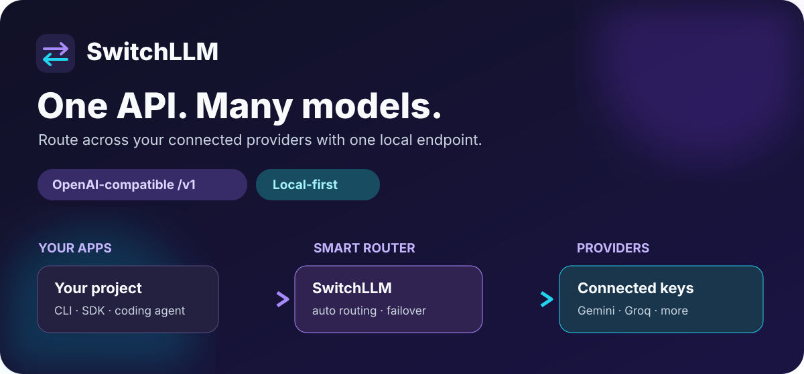
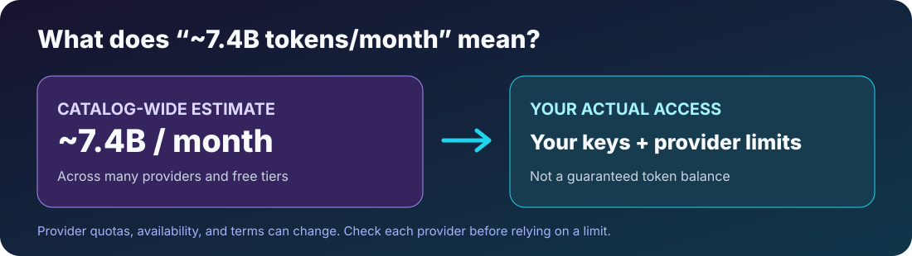

<div align="center">

# SwitchLLM

### One local API. Your choice of models.



[](./LICENSE)  

**SwitchLLM** brings the free tiers of supported AI providers behind a single OpenAI-compatible endpoint. Add your own provider keys, then use `auto` to route requests to an available model. Keys are encrypted locally; automatic fallback helps when a provider hits a limit.

[Quick start](#quick-start) · [Use in a project](#works-with-openai-compatible-clients) · [API example](#using-the-api) · [Original project](https://github.com/tashfeenahmed/freellmapi)

**Important:** The upstream catalog's ~7.4B tokens/month figure is an *aggregate estimate across listed providers and free tiers*, **not** a personal token balance, guaranteed allocation, or tokens issued by SwitchLLM. Your usable quota depends on your own provider accounts, keys, model limits, region, and changing provider terms. [How the estimate works ↓](#what-does-74b-tokens-mean)

**English** · [简体中文](README.zh-cn.md)

</div>

---

## Contents

- [Why this exists](#why-this-exists)
- [What does 7.4B tokens mean?](#what-does-74b-tokens-mean)
- [Supported providers](#supported-providers)
- [Provider keys: Cloudflare and GitHub Models](#provider-keys-cloudflare-and-github-models)
- [Compatible CLIs & coding agents](#compatible-clis--coding-agents)
- [Features](#features)
- [Quick start](#quick-start)
- [Desktop app](#desktop-app)
- [Works with OpenAI-compatible clients](#works-with-openai-compatible-clients)
- [Languages](#languages)
- [Catalog updates](#catalog-updates)
- [Using the API](#using-the-api)
- [Visual tour](#visual-tour)
- [How it works](#how-it-works)
- [FAQ](#faq)
- [Limitations](#limitations)
- [Contributing](#contributing)
- [Disclaimer](#disclaimer)

**Guides:** [Install & deploy](docs/en/install/01-install.md) · [API reference](docs/en/api/01-rest-api.md) · [Clients & coding agents](docs/en/clients/01-agent-clients.md) · [Prompt compression](docs/en/compression/01-compression-pipeline.md) · [Architecture & internals](docs/en/architecture/00-high-level-index.md) · [Documentation index](docs/en/README.md) · [Contributor guide](CONTRIBUTING.md)

## Why this exists

Some AI providers offer free tiers, each with its own quota and conditions. SwitchLLM gives you one endpoint for the providers **you configure**, so your app does not have to manage every SDK and rate limit itself.

Point an OpenAI-compatible client at your local SwitchLLM server. It routes across healthy models backed by your keys and can fail over when one is rate-limited.

The free-tier landscape shifts: providers launch models, retire them, and change quotas. SwitchLLM pulls a signed model catalog from the [upstream catalog site](https://freellmapi.co), with the timing described under [Catalog updates](#catalog-updates).

## What does 7.4B tokens mean?

The [original project's published catalog](https://github.com/tashfeenahmed/freellmapi) lists roughly **7.4 billion tokens/month of combined free-tier capacity** across many provider/model endpoints. That is a catalog-wide estimate, **not 7.4B tokens credited to your account**. You only have access to the providers for which you have valid accounts and keys; some limits are request-based, shared across models, or unpublished. Provider limits can change at any time. The dashboard shows your configured providers and observed usage; check each provider's current terms before relying on a quota.

| You get | You do not get |
| --- | --- |
| One local API key for the router | An automatic 7.4B-token balance |
| Routing across providers you connect | Every listed model without its provider key |
| Visibility into available models and usage | A guarantee that free tiers remain free or available |




## Supported providers

<div align="center">
<table>
<tr>
<td align="center" width="150"><br/><b>Google</b></td>
<td align="center" width="150"><picture><source media="(prefers-color-scheme: dark)" srcset="repo-assets/providers/groq-dark.png"></picture><br/><b>Groq</b></td>
<td align="center" width="150"><br/><b>Cerebras</b></td>
<td align="center" width="150"><picture><source media="(prefers-color-scheme: dark)" srcset="repo-assets/providers/opencode-dark.png"></picture><br/><b>OpenCode Zen</b></td>
</tr>
<tr>
<td align="center"><br/><b>Mistral</b></td>
<td align="center"><br/><b>OpenRouter</b></td>
<td align="center"><br/><b>Cloudflare</b></td>
<td align="center"><br/><b>Cohere</b></td>
</tr>
<tr>
<td align="center"><br/><b>Z.ai (Zhipu)</b></td>
<td align="center"><br/><b>NVIDIA</b></td>
<td align="center"><br/><b>HuggingFace</b></td>
</tr>
<tr>
<td align="center"><a href="https://modelscope.cn"><b>ModelScope</b><br/>Qwen3 · DeepSeek V4 · GLM-5 (needs Aliyun cn binding)</a></td>
</tr>
</table>

<i>… and 22 more free providers</i>

</div>

Plus a **custom** provider — point chat, embedding, image, or audio models at any OpenAI-compatible endpoint (llama.cpp, LM Studio, vLLM, a local Ollama, or a remote gateway) from the Keys page.

The full, always-current list lives at **[upstream catalog site/models](https://freellmapi.co/models.html)** with per-model rate limits, context windows, and free-token budgets.

## Provider keys: Cloudflare and GitHub Models

Provider credentials go into **SwitchLLM dashboard → Keys**. They are different from the **SwitchLLM unified API key** that your projects use. Never put provider tokens in Git or a public issue.

- **Cloudflare Workers AI:** In the [Cloudflare Workers AI REST API setup](https://developers.cloudflare.com/workers-ai/get-started/rest-api/), open **Workers AI → Use REST API**. Copy both the **API token** and the **Account ID** shown under **Get Account ID**. If you make a custom token instead of using Cloudflare's template, grant **Account → Workers AI → Read** and **Edit**, scoped to your account. SwitchLLM asks for the token and Account ID separately and uses them together for Cloudflare requests.
- **GitHub Models:** On GitHub's token page, choose a **fine-grained personal access token** with **Account permissions → Models → Read**; repository write access is not needed for model inference. This is a *GitHub* token, not a Cloudflare Account ID. [GitHub's `models:read` requirement](https://github.blog/changelog/2025-05-15-modelsread-now-required-for-github-models-access/).

After adding either provider, use **Test** on the Keys page. Your available models and usage limits depend on that provider's account and current terms.

## Compatible CLIs & coding agents

<div align="center">
<table>
<tr>
<td align="center" width="150"><br/><b>Claude Code</b></td>
<td align="center" width="150"><br/><b>Codex CLI</b></td>
<td align="center" width="150"><br/><b>Gemini CLI</b></td>
<td align="center" width="150"><br/><b>Aider</b></td>
</tr>
<tr>
<td align="center"><br/><b>Cline</b></td>
<td align="center"><br/><b>Roo Code</b></td>
<td align="center"><br/><b>Continue</b></td>
<td align="center"><br/><b>OpenCode</b></td>
</tr>
<tr>
<td align="center"><br/><b>Goose</b></td>
<td align="center"><br/><b>Qwen Code</b></td>
<td align="center"><br/><b>Kilo Code</b></td>
<td align="center"><br/><b>Crush</b></td>
</tr>
<tr>
<td align="center"><br/><b>Cursor</b></td>
<td align="center"><br/><b>Zed</b></td>
<td align="center"><br/><b>JetBrains AI</b></td>
<td align="center"><br/><b>DeepSeek Harness</b></td>
</tr>
<tr>
<td align="center"><br/><b>AtomCode</b></td>
<td align="center"><br/><b>OpenClaw</b></td>
<td align="center"><br/><b>Hermes Agent</b></td>
</tr>
</table>

<i>… plus any OpenAI-compatible client, Anthropic SDK, Gemini SDK, or Ollama-capable app</i>

</div>

The included CLI can generate configuration for Claude Code, Codex, Aider, and other agents from your live model catalog. Run it from a built source checkout with `node cli/dist/index.js` (for example, `node cli/dist/index.js setup-codex --help`). Session-only launchers can inject credentials into Claude Code and Codex without saving them in those clients' config files. Zed and JetBrains AI connect through the opt-in [Ollama emulation](docs/en/clients/01-agent-clients.md#ollama-clients); Gemini CLI speaks its native wire on `/v1beta`.

Per-tool recipes, the setup CLI reference, revocable URL tokens for headerless clients, and the MCP server all live in **[Clients & coding agents →](docs/en/clients/01-agent-clients.md)**

## Features


- **Every OpenAI-style surface** — `/v1/chat/completions`, `/v1/responses` (what Codex CLI needs), `/v1/completions` (editor ghost-text autocomplete), `/v1/images/generations`, `/v1/videos/generations`, `/v1/audio/speech`, `/v1/audio/transcriptions`, `/v1/embeddings`, and `/v1/models` — streaming and non-streaming, from the official SDKs or any OpenAI-compatible client. [API reference →](docs/en/api/01-rest-api.md)
- **Anthropic Messages API** — `/v1/messages` speaks Anthropic's wire format over the same router, so **Claude Code** and the official Anthropic SDKs run against your free pool. [Details →](docs/en/api/01-rest-api.md#anthropic--claude-clients)
- **Native Gemini + Ollama surfaces** — Gemini CLI can use `/v1beta` (`generateContent`, streaming, token counting, models), while opt-in Ollama emulation serves NDJSON chat/generate, tags, metadata, and embeddings for Zed, JetBrains, and other local-model clients.
- **Fusion (multi-model synthesis)** — request the virtual `fusion` model and the router fans your prompt out to a panel of diverse free models in parallel, then a judge model synthesizes one answer from the drafts. [Details →](docs/en/api/01-rest-api.md#fusion-multi-model-synthesis)
- **Image, video & speech generation** — `/v1/images/generations`, `/v1/videos/generations`, and `/v1/audio/speech` route across the providers that serve media models; images and speech also accept custom OpenAI-compatible media endpoints. Video jobs are normalized across synchronous and queued providers and return a completed MP4.
- **Tool calling & structured outputs** — OpenAI-style `tools` round-trip across providers (plain-text tool calls are rescued into real `tool_calls`), plus `response_format`, `seed`, `logprobs`, penalties, and the rest of the sampling params passed through per provider.
- **Smart routing, six strategies** — live per-model speed/capability/reliability scores rank your chain; automatic fallover retries the next model on 429/5xx with cooldowns and key rotation. [Routing in detail →](docs/en/architecture/00-high-level-index.md#how-it-works)
- **Unified models & profiles** — the same model on several providers collapses into one entry with strict in-group failover; named fallback-chain profiles (a coding chain, a vision chain) switch from the dashboard or per request via `auto:<profile>`, and custom chains can be renamed in place from the chain manager.
- **Per-key rate tracking** — RPM/RPD/TPM/TPD counters per `(platform, model, key)` that learn providers' reported ceilings, so routing always stays under every cap.
- **Self-updating model catalog** — the router checks the signed upstream catalog for model, quota, and compatibility updates; free installs receive the monthly snapshot. [Catalog updates →](#catalog-updates)
- **Sticky sessions & context handoff** — conversations stay on one model for 30 minutes; an optional compact handoff note keeps the thread coherent when a mid-chat switch does happen. [Details →](docs/en/clients/01-agent-clients.md#context-handoff)
- **Prompt compression (opt-in)** — a shared, fail-open request pipeline can deduplicate prompts, filter tool output, compact repeated JSON, and trim stale context before cache lookup and routing. [Details →](docs/en/compression/01-compression-pipeline.md)
- **Encrypted keys, one token out** — provider keys are AES-256-GCM encrypted in SQLite and decrypted in-memory per request; your apps only ever see a single unified `switchllm-…` bearer token.
- **Admin dashboard & analytics** — React UI to manage keys, reorder the chain, run a playground, and read p50/p95/TTFT analytics over 24h–90d windows; login-gated, dark/light themes, [60 languages](#languages).
- **ChatGPT-ready MCP server & interactive docs** — ChatGPT and other MCP clients can call SwitchLLM inference, list usable models, inspect provider health/usage/cache/routing metadata, and manage the routing strategy over `/mcp`; a dependency-free OpenAPI viewer lives at `/v1/docs`. [ChatGPT and coding agents →](docs/en/clients/01-agent-clients.md#mcp-server)
- **Ops niceties** — opt-in response cache, encrypted DB backups, periodic key health checks, bulk key import/export, declarative startup config. [Install & deploy →](docs/en/install/01-install.md)
- **Runs anywhere Node 20+ runs** — Windows, macOS, Linux servers, or a small ARM SBC (Raspberry Pi included). ~40 MB RSS at idle behind PM2 / systemd / whatever supervisor you prefer.

The scope is deliberately narrow — see [what's not supported yet](docs/en/architecture/00-high-level-index.md#not-yet-supported).

## Quick start

**Run SwitchLLM from source** (Node.js 20.18+ and npm 10+):

```bash
npm ci
npm run build
node server/dist/index.js
```

Open **http://localhost:3001** (default port), create your local dashboard account, then add your own provider keys under **Keys**. The server must remain running while your apps use the API. For production, set a strong `ENCRYPTION_KEY` in a private `.env` file; see [.env.example](.env.example) and the [installation guide](docs/en/install/01-install.md).

If port 3001 is already in use, set `PORT=3011` (or another available port) in a private `.env` file and use that port in the URLs below.

The [upstream install script](https://freellmapi.co/install.sh) and [upstream releases](https://github.com/tashfeenahmed/freellmapi/releases/latest) install **the original FreeLLMAPI**, not this SwitchLLM fork. Build this fork from source for SwitchLLM branding. On Android, see the experimental [Termux guide](docs/en/install/02-android-termux.md).

Everything else — Docker Compose, local development, declarative startup config, production builds, LAN access, and backups — is in **[docs/en/install/01-install.md](docs/en/install/01-install.md)**.

## Desktop app

A native menu-bar app lives in [`desktop/`](./desktop): the entire router + dashboard running locally from your tray, with a glass popover showing live request stats.


The desktop source is included, but **this fork does not currently publish SwitchLLM-branded installers**. Build-from-source steps and data locations: [docs/en/install/01-install.md#desktop-app](docs/en/install/01-install.md#desktop-app). [Upstream releases](https://github.com/tashfeenahmed/freellmapi/releases/latest) are branded FreeLLMAPI.

For macOS 12 Monterey or later, choose **arm64 (Apple Silicon)** or **x64 (Intel)**. Both Mac builds also include a ZIP download.

## Works with OpenAI-compatible clients

Anything that can target an OpenAI-compatible base URL works: set it to `http://localhost:3001/v1` with the unified key from the dashboard. **Claude Code**, **Codex CLI**, **Cline / Roo Code**, **Continue** (including inline autocomplete), **Aider**, **opencode**, and **Cursor** each have a short recipe in **[docs/en/clients/01-agent-clients.md](docs/en/clients/01-agent-clients.md)** — and the router doubles as an MCP server your agents can introspect mid-session.

**ChatGPT** connects to the same local router through a private Secure MCP Tunnel. The
`ask_switchllm` MCP tool routes a ChatGPT-requested task through `/v1/chat/completions` and
returns the answer with served-model, fallback, cache, execution, and token metadata. Base
URL and bearer authentication live in the tunnel-client configuration; the default model is
set with `MCP_INFERENCE_DEFAULT_MODEL` (`auto` when unset). No key belongs in Git or in the
MCP URL. **[ChatGPT setup →](docs/en/clients/01-agent-clients.md#chatgpt-private-secure-mcp-tunnel)**

The fastest setup is generated from the models available on your live server:

```bash
node cli/dist/index.js setup-claude --url http://localhost:3001 --api-key <unified-key>
```

Every generator supports `--dry-run`, creates a timestamped backup before changing an existing file, and merges into the user's configuration. Launchers keep credentials out of config files entirely: `node cli/dist/index.js launch` for Claude Code and `node cli/dist/index.js launch-codex` for Codex.

Provider keys can be managed from the terminal too, with a dashboard session token (`SWITCHLLM_DASHBOARD_TOKEN` or `--token`): `node cli/dist/index.js keys add|list|remove|test <platform>`, where `keys test` re-checks stored keys. See [cli/README.md](cli/README.md#provider-keys).

| Agent | Automated setup | Base URL |
| --- | --- | --- |
| Claude Code | `setup-claude` | root |
| Codex CLI | `setup-codex` | `/v1` |
| Cline | `setup-cline` | `/v1` |
| Continue | `setup-continue` | `/v1` |
| Aider | `setup-aider` | `/v1` |
| OpenCode | `setup-opencode` | `/v1` |
| Goose | `setup-goose` | `/v1` |
| Qwen Code | `setup-qwen` | `/v1` (or native `/v1beta`) |
| Roo / Kilo / Crush | `setup-roo` / `setup-kilo` / `setup-crush` | `/v1` |
| DeepSeek Harness | `setup-dsh` | `/v1` |
| MiMo Code | `setup-mimo` | `/v1` |
| AtomCode | `setup-atomcode` | `/v1` |
| OpenClaw | `setup-openclaw` | `/v1` |
| Hermes Agent | `setup-hermes` | `/v1` |
| Cursor | `setup-cursor` guide | public `/v1` URL |

SwitchLLM is local-first and single-user by design. Your provider keys stay in your SQLite database, encrypted at rest, and requests go from your machine to the upstream providers you enabled.

## Languages

The dashboard ships in **60 languages** (the desktop tray menu in 6). The UI
auto-detects your browser/system language on first load and you can switch any
time from **⋯ → Settings**; the choice is remembered. Right-to-left languages
(العربية, עברית, فارسی, اردو) flip the whole layout automatically, and only the
active language's dictionary is loaded — the rest never touch your bandwidth.

                                                 

The full list of locales lives in
[`client/src/i18n/locale-config.ts`](./client/src/i18n/locale-config.ts).

The original six locales are human-reviewed; the newer ones are machine-
translated and improve as native speakers send corrections — a one-string PR is
a great first contribution.

Translations live in [`client/src/i18n/locales/`](./client/src/i18n/locales) as
flat JSON files. To fix a string, edit the value in the locale's JSON file. To
add a language, copy `en.json`, translate the values, and register the locale in
`client/src/i18n/locale-config.ts` (and `desktop/src/i18n.ts` for the tray
strings); `npm test` checks every locale for key/placeholder parity — PRs
welcome.

## Catalog updates

The router keeps its model catalog fresh on its own: it pulls a signed catalog
from [upstream catalog site](https://freellmapi.co) twice a day and applies new models,
quota changes, and provider quirk fixes to your local DB. Your own
enable/disable choices and custom providers are never touched, and every
download is verified against a pinned Ed25519 key before it is applied.

The upstream catalog has published figures of **34 providers**, **474 model
families**, **635 free provider/model endpoints**, and roughly **7.4 billion
tokens per month** of aggregate listed free-tier capacity. These are catalog
estimates, not a personal balance; counts and limits can change. Browse the full set at
**[upstream catalog site/models](https://freellmapi.co/models.html)**.

Free installs pull the monthly snapshot; upstream says newly listed models join
that snapshot after a delay. Live-feed access is an upstream service, separate
from this fork. For current availability and terms, consult the
[upstream catalog site](https://freellmapi.co). SwitchLLM does not issue token
credits or operate that catalog service.

The catalog server never sees your prompts, completions, or provider keys — the
router stays fully self-hosted either way.

## Using the API

```python
from openai import OpenAI

client = OpenAI(
    base_url="http://localhost:3001/v1",
    api_key="switchllm-your-unified-key",
)

raw = client.chat.completions.with_raw_response.create(
    model="auto",  # let the router pick; or "auto:fast", "auto:smart", a profile, or a model id
    messages=[{"role": "user", "content": "Summarise the fall of Rome in one sentence."}],
)
resp = raw.parse()
print(resp.choices[0].message.content)
print("Routed via:", raw.headers.get("x-routed-via"))
```

Streaming, the `auto:*` routing strategies, tool calling, vision input, Gemini Google Search grounding, embeddings, and the Anthropic Messages surface — with curl and Python examples for each — are all in **[docs/en/api/01-rest-api.md](docs/en/api/01-rest-api.md)**. Every response carries an `X-Routed-Via: <platform>/<model>` header so you can see which provider actually served it.

## Visual tour

The illustrations below explain the flow; they are not live dashboard screenshots.


In the live dashboard, **Models** lets you choose a routing strategy, **Keys** manages provider credentials and your unified API key, **Playground** sends test prompts, and **Analytics** shows request and token usage. Actual screens and available models depend on your installation and connected providers.


## How it works


One request in, the best free model out: the router picks the highest-priority model with a healthy key that's under all its rate limits, decrypts the key in memory, and calls the provider — on a 429/5xx it cools that key down and retries the next model in your chain. The component walkthrough, routing internals, and operational details live in **[docs/en/architecture/00-high-level-index.md](docs/en/architecture/00-high-level-index.md)**.

## FAQ

**Do I need a password?** Not for the desktop app — the dashboard signs itself in with a hidden local account, so there is nothing to set up and nothing to forget. Open it from the tray icon → **Open Dashboard**. Server installs (Docker, one-liner, `npm run dev`) do have an email + password account.

**I forgot the password on a server install.** Click **Forgot password?** on the login page. There is no email to send a link to, so the one-time code is printed to the server log — read it with `docker compose logs -f switchllm` (or in the terminal running the server, or in the desktop log file), then enter it on the reset form. The code lasts 15 minutes.

**Where are the logs?** In the container log for Docker, in the terminal for a source run, and in `<data dir>/logs/switchllm.log` for the desktop app — reachable from the tray menu's **Open Logs Folder**.

**How do I uninstall?** Remove the app (Trash on macOS, *Settings → Apps* on Windows, `docker compose down -v` for Docker), then delete the data directory: `%APPDATA%\SwitchLLM\`, `~/Library/Application Support/SwitchLLM/`, or `~/.config/SwitchLLM/`. Uninstalling never touches that folder on its own.

Longer answers, per install method: **[docs/en/install/01-install.md#faq-passwords-logs-uninstall](docs/en/install/01-install.md#faq-passwords-logs-uninstall)**.

## Limitations

Stacking free tiers has real trade-offs: no frontier models, variable latency, no SLA — and the effective intelligence of the endpoint dips late in the day as top models hit their daily caps, then resets at UTC midnight. Read the honest list in **[docs/en/architecture/00-high-level-index.md#limitations](docs/en/architecture/00-high-level-index.md#limitations)** before building anything real on this.

## Contributing

Contributors very welcome! See [CONTRIBUTING.md](CONTRIBUTING.md) for the dev loop, PR expectations, and the policy on AI/LLM-assisted contributions (short version: welcome, same quality bar as any other PR). Good first PRs:

- **Add a provider** — copy `server/src/providers/openai-compat.ts` as a template, wire it into `server/src/providers/index.ts`, seed its models in `server/src/db/index.ts`, add a test in `server/src/__tests__/providers/`.
- **Add an endpoint** — moderations and other OpenAI-compatible surfaces. The provider base class can grow new methods; adapters declare which they support.
- **Improve the router** — cost-aware routing (cheapest-healthy-fastest tradeoffs), better latency-weighted priority, regional pinning.
- **Dashboard polish** — charts on the Analytics page, key rotation UX, batch import of keys from `.env`.
- **Docs** — more examples, client library snippets for Go/Rust/etc., a deployment recipe for Docker or Fly.

`npm install && npm run dev` gets you the server on :3001 and the dashboard on :5173, both with HMR. For a repeatable setup, use `./scripts/dev-bootstrap.sh` on Bash or `.\scripts\dev-bootstrap.ps1` on PowerShell; each preserves an existing `.env`. PRs should include a test, keep the existing suite green (`npm test`), and match the `.editorconfig` / tsconfig defaults already in the repo. Database migration workflow and the full contributor loop are in [CONTRIBUTING.md](./CONTRIBUTING.md).

### Contributors

<a href="https://github.com/moaaz12-web"></a>
<a href="https://github.com/lukasulc"></a>
<a href="https://github.com/VinhPhamAI"></a>
<a href="https://github.com/deadc"></a>
<a href="https://github.com/zhangyu1324"></a>
<a href="https://github.com/kentpan"></a>
<a href="https://github.com/stephenzwj"></a>
<a href="https://github.com/chongjiazhen"></a>
<a href="https://github.com/vjsai"></a>
<a href="https://github.com/long2ice"></a>
<a href="https://github.com/sadesguy"></a>
<a href="https://github.com/hodlmybeer69-bit"></a>
<a href="https://github.com/phoenixikkifullstack"></a>
<a href="https://github.com/jtbrennan-git"></a>
<a href="https://github.com/praveenkumarpranjal"></a>
<a href="https://github.com/nordbyte"></a>
<a href="https://github.com/mybropro"></a>
<a href="https://github.com/danscMax"></a>
<a href="https://github.com/jhash"></a>
<a href="https://github.com/JammyJames1234"></a>
<a href="https://github.com/coffcoe"></a>
<a href="https://github.com/Sumit4codes"></a>
<a href="https://github.com/meliani"></a>
<a href="https://github.com/thedavidweng"></a>
<a href="https://github.com/bharvey42"></a>
<a href="https://github.com/yuvrxj-afk"></a>
<a href="https://github.com/Tushar49"></a>
<a href="https://github.com/nicyoong"></a>
<a href="https://github.com/Aldo-f"></a>
<a href="https://github.com/Tazrif-Raim"></a>
<a href="https://github.com/m1nuzz"></a>
<a href="https://github.com/suantea"></a>
<a href="https://github.com/OhOkThisIsFine"></a>
<a href="https://github.com/LoneRifle"></a>
<a href="https://github.com/ita333"></a>
<a href="https://github.com/barbotkonv"></a>
<a href="https://github.com/Naster17"></a>
<a href="https://github.com/StealthTensor"></a>
<a href="https://github.com/EmranAhmed"></a>
<a href="https://github.com/itsfuad"></a>
<a href="https://github.com/RobinHoodO"></a>
<a href="https://github.com/hmm183"></a>
<a href="https://github.com/duemilionidieuro-bot"></a>
<a href="https://github.com/cagedbird043"></a>
<a href="https://github.com/jasnoorgill"></a>
<a href="https://github.com/Joey9024"></a>
<a href="https://github.com/AskingConical"></a>
<a href="https://github.com/ProAlit"></a>
<a href="https://github.com/hjhhoni"></a>
<a href="https://github.com/immanuelsavio"></a>
<a href="https://github.com/Slyker"></a>
<a href="https://github.com/wells1013"></a>
<a href="https://github.com/evgkrsk"></a>
<a href="https://github.com/aaronjmars"></a>
<a href="https://github.com/Robs87"></a>
<a href="https://github.com/dashitongzhi"></a>
<a href="https://github.com/QingJ01"></a>
<a href="https://github.com/3215"></a>
<a href="https://github.com/saifulaiub123"></a>
<a href="https://github.com/PietFourie"></a>
<a href="https://github.com/mhmdkrmabd"></a>
<a href="https://github.com/DemeulemeesterxMaxime"></a>
<a href="https://github.com/HoodBlah"></a>
<a href="https://github.com/SeanPedersen"></a>
<a href="https://github.com/andersmmg"></a>
<a href="https://github.com/chirag127"></a>
<a href="https://github.com/allababbot"></a>
<a href="https://github.com/johan-droid"></a>
<a href="https://github.com/redenfire"></a>
<a href="https://github.com/itzpingcat"></a>
<a href="https://github.com/kairwang01"></a>
<a href="https://github.com/gongjurenzhangwei"></a>
<a href="https://github.com/jsonring"></a>
<a href="https://github.com/1029734570"></a>
<a href="https://github.com/86TheCactus"></a>
<a href="https://github.com/AmiroKD"></a>
<a href="https://github.com/ecryptomillionaire-dev"></a>
<a href="https://github.com/4riful"></a>
<a href="https://github.com/fix2015"></a>
<a href="https://github.com/iisyw"></a>
<a href="https://github.com/xsfhacg"></a>
<a href="https://github.com/noobix"></a>
<a href="https://github.com/nandukmelath"></a>
<a href="https://github.com/NirvanaCh7"></a>
<a href="https://github.com/Mohamed3nan"></a>
<a href="https://github.com/Arman-Espiar"></a>
<a href="https://github.com/MetaMysteries8"></a>
<a href="https://github.com/lujun880726"></a>
<a href="https://github.com/qq97693453"></a>
<a href="https://github.com/emv33"></a>
<a href="https://github.com/ousamabenyounes"></a>
<a href="https://github.com/yfdyh000"></a>
<a href="https://github.com/s-uryansh"></a>
<a href="https://github.com/arsalanyavari"></a>
<a href="https://github.com/RoboMWM"></a>
<a href="https://github.com/gaurang-py"></a>
<a href="https://github.com/ddy4633"></a>
<a href="https://github.com/UrbsKali"></a>
<a href="https://github.com/hb-0"></a>
<a href="https://github.com/xyblue135"></a>
<a href="https://github.com/Icesenator"></a>
<a href="https://github.com/ZER0-auto"></a>
<a href="https://github.com/tashdroid"></a>
<a href="https://github.com/Patrickleondev"></a>
<a href="https://github.com/hiiamwaffledev"></a>
<a href="https://github.com/w0fv1"></a>
<a href="https://github.com/oppih"></a>
<a href="https://github.com/n3dhir"></a>
<a href="https://github.com/ksp2000"></a>
<a href="https://github.com/quabynahdavis"></a>
<a href="https://github.com/qinghuanandejiangshi"></a>
<a href="https://github.com/qatcod"></a>
<a href="https://github.com/CooperSheroy"></a>
<a href="https://github.com/shahidbeig-a11y"></a>
<a href="https://github.com/Kaban15"></a>
<a href="https://github.com/efcunha"></a>
<a href="https://github.com/sukaimi"></a>
<a href="https://github.com/rome-xi"></a>
<a href="https://github.com/bsi-bcp"></a>
<a href="https://github.com/rodion-gudz"></a>
<a href="https://github.com/bjornmage"></a>
<a href="https://github.com/kenanlabs"></a>
<a href="https://github.com/xzyj50609"></a>
<a href="https://github.com/Ahmedtahoon2"></a>
<a href="https://github.com/Inference1"></a>
<a href="https://github.com/yzhkali"></a>
<a href="https://github.com/levonk"></a>
<a href="https://github.com/tripstar6000"></a>

## Disclaimer

**This project is for personal experimentation and learning, not production.** Free tiers exist so developers can prototype against them; they aren't a stable, supported inference substrate and shouldn't be treated as one. If you build something real on top of SwitchLLM, swap in a paid API before you ship. Your relationship with each upstream provider is governed by the terms you accepted when you created your account — those terms still apply when the traffic is proxied through this project, and you're responsible for complying with them.

How each provider's ToS views a personal, single-user proxy — reviewed provider by provider in May 2026 — is in [docs/en/architecture/00-high-level-index.md#terms-of-service-review](docs/en/architecture/00-high-level-index.md#terms-of-service-review).

## License

[MIT](./LICENSE)
